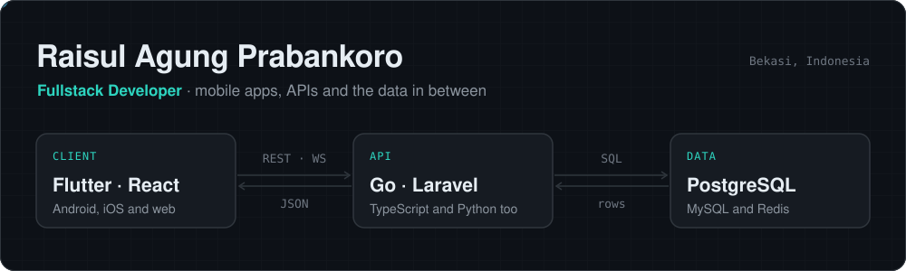

### Fullstack Engineer · Backend & Systems

I build reliable software that turns complex business workflows into systems people depend on every day.

My main tool is **Go**: high-throughput APIs, real-time data pipelines, and the integrations around them. I also work across the rest of the stack, from database design and architecture to the **Flutter** or **React** app on top. I care about what happens after launch: how a system behaves under load, how it handles failure, and whether it moves the numbers it was built for.

**What I do**

- **Backend & APIs:** REST and WebSocket services in Go, Laravel, Node.js and FastAPI, with auth, RBAC and solid data models
- **Real-time systems:** ingesting high-frequency GPS telemetry from vehicle fleets and streaming it live to dashboards and mobile apps
- **Payments:** Xendit flows that stay correct through pending, failed and timed-out transactions
- **Applied AI:** an LLM screening service that scores deterministically first and calls the model only when needed, cutting inference cost by 70%+; face-recognition check-in with InsightFace and pgvector
- **Mobile & web:** Flutter apps shipped to Google Play, React and Next.js dashboards
- **Ownership:** from schema design and deployment to fixing production incidents

[LinkedIn](https://www.linkedin.com/in/raisulap) · [Email](mailto:raisulagung@gmail.com) · [Instagram](https://instagram.com/thesul_ap)

## Stack

**Main tools**

**Also work with**

## GitHub

  
  

<picture>
  <source media="(prefers-color-scheme: dark)" srcset="https://raw.githubusercontent.com/RaisulAp/RaisulAp/output/github-snake-dark.svg" />
  <source media="(prefers-color-scheme: light)" srcset="https://raw.githubusercontent.com/RaisulAp/RaisulAp/output/github-snake.svg" />
  
</picture>
